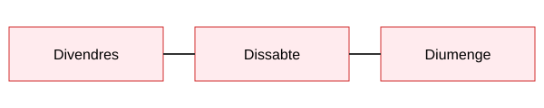

# Curses de MotoGP

Aquesta pàgina és la meva documentació per a la **Pràctica 3** del Projecte Intermodular. Explica de manera senzilla com funcionen les curses de **MotoGP**.

## Què és MotoGP?

MotoGP és el campionat del món de motociclisme de velocitat. Els pilots corren en circuits tancats amb motos fetes només per a la competició i, al final de la temporada, el pilot amb més punts guanya el títol.

!!! note "Nota"
    El campionat està organitzat per la FIM i per l'empresa Dorna Sports.

## Contingut

- **Campionat**: les categories i com és un cap de setmana de cursa.
- **Reglament**: els punts i les banderes.

Més informació a la [web oficial de MotoGP](https://www.motogp.com/).
