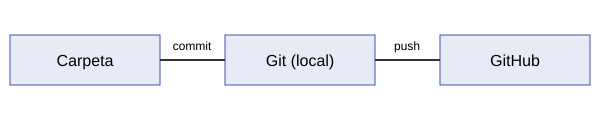

# Git i GitHub

Aquesta pàgina és la meva documentació per a la **Pràctica 3** del Projecte Intermodular. Explica de manera senzilla què són *Git* i *GitHub* i com es fan servir.

## Què és Git?

Git és un programa de **control de versions**. Guarda els canvis que fem en els fitxers d'un projecte i ens permet tornar a una versió anterior si ens equivoquem.

## Què és GitHub?

GitHub és una pàgina web on es poden guardar repositoris de Git. Així tenim una còpia al núvol i també podem compartir el projecte.

!!! note "Nota"
    Git i GitHub no són el mateix: Git és el programa i GitHub és el servei web.

## Contingut

- **Git**: instal·lació i ordres bàsiques.
- **GitHub**: repositori remot i GitHub Pages.

Més informació a la [web oficial de Git](https://git-scm.com/).
